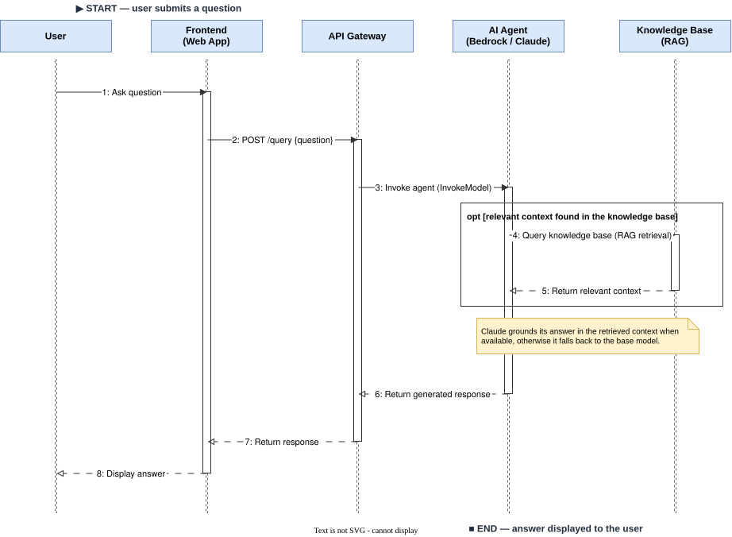

# AI Agent Interaction — Sequence Diagram

A sequence diagram documenting the request/response flow between a user and an AI agent (Amazon Bedrock / Claude) that can optionally query a knowledge base for retrieval-augmented generation (RAG).



## Scenario

A user asks a question through a web interface. The frontend forwards the request to an API Gateway, which invokes the AI agent. If relevant context exists in the knowledge base, the agent retrieves it before generating a grounded response. The response then travels back through the same path to the user.

## Participants (lifelines)

| Participant | Role |
|---|---|
| **User** | Submits the question and receives the final answer. |
| **Frontend (Web App)** | Entry point UI; forwards the question and displays the response. |
| **API Gateway** | Routes the request to the AI agent and returns its response. |
| **AI Agent (Bedrock / Claude)** | Generates the answer, optionally grounding it in retrieved context. |
| **Knowledge Base (RAG)** | Stores retrievable context queried by the agent when relevant. |

## Flow

1. **User → Frontend**: Ask question.
2. **Frontend → API Gateway**: `POST /query {question}`.
3. **API Gateway → AI Agent**: Invoke agent (`InvokeModel`).
4. *(opt — if relevant context found in the knowledge base)*
   - **AI Agent → Knowledge Base**: Query knowledge base (RAG retrieval).
   - **Knowledge Base ⇢ AI Agent**: Return relevant context.
5. The agent generates the response, grounding it in the retrieved context when available (see note in the diagram).
6. **AI Agent ⇢ API Gateway**: Return generated response.
7. **API Gateway ⇢ Frontend**: Return response.
8. **Frontend ⇢ User**: Display answer.

Solid arrows are synchronous calls; dashed arrows are their returns. The `opt` frame marks the conditional RAG lookup, and activation bars show each component's processing window.

## Diagram source

- Editable source: [docs/sequence-diagram.drawio](docs/sequence-diagram.drawio)
- Rendered exports: [SVG](docs/sequence-diagram.svg) / [PNG](docs/sequence-diagram.png)

To regenerate:

```bash
python3 -m venv .diagram-venv
.diagram-venv/bin/pip install drawpyo

.diagram-venv/bin/python scripts/generate_diagram.py

# Rasterize to SVG/PNG
docker run --rm -v "$PWD/docs":/data -w /data rlespinasse/drawio-export -f svg -o . --output-mode relative --remove-page-suffix .
docker run --rm -v "$PWD/docs":/data -w /data rlespinasse/drawio-export -f png -o . --output-mode relative --remove-page-suffix -t .
```

The SVG export is transparent by default; the regeneration script output must be patched with a white background rect (see repo notes) before embedding in Markdown.
